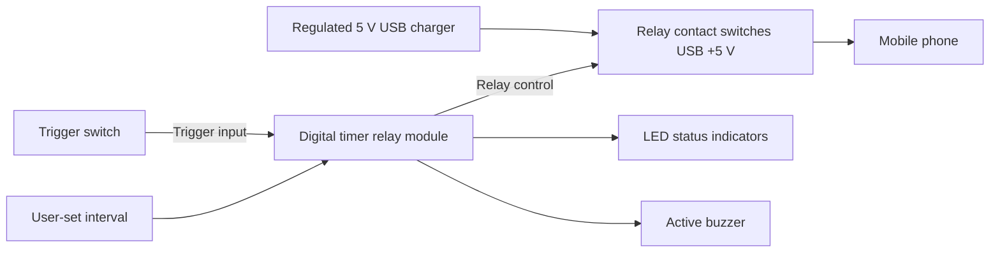

# Smart Mobile Charging Cut-Off System Using Timer Relay

A hardware prototype that disconnects a mobile phone's USB charging supply after a user-configured time interval. It uses an external digital timer relay module, a trigger switch, relay contacts, and LED/buzzer indicators.

> **Operating principle:** This is a timer-based cutoff. It does not read the phone's battery percentage, detect 100% charge, or communicate with the phone's battery-management system.

## Functional block diagram

This is a functional overview, not a pin-level schematic. Timer-module power wiring and relay terminal selection must follow the exact module manual.

## Intended operation

1. Set the desired interval on the digital timer relay module.
2. Connect the phone through the USB cable and relay-switched positive supply path.
3. Activate the trigger switch to start the configured timing operation.
4. The timer module controls the relay during the interval.
5. At timeout, the module changes relay state according to its selected mode; the charging path is intended to open.
6. LEDs and buzzer provide the configured status/completion indication.

**Important:** Confirm relay state at idle, during countdown, and after timeout with a multimeter. The exact timeout behavior depends on the module mode and configuration.

## Hardware

- Digital timer relay module with display and buttons
- Trigger switch
- Regulated 5 V USB charger and USB cable
- Active buzzer
- Green and red LEDs with current-limiting resistors
- Jumper/connecting wires
- Timer-module power supply matching its specified input range

See [components](hardware/components.md) and [wiring notes](hardware/wiring.md).

## Repository guide

| Path | Contents |
|---|---|
| `hardware/` | Component list, wiring notes, functional block diagram |
| `docs/architecture.md` | System architecture and power domains |
| `docs/algorithm.md` | Operating sequence |
| `docs/design-decisions.md` | Rationale, trade-offs, limitations |
| `docs/testing.md` | Bench and phone test checklist |
| `docs/contribution-and-ai-disclosure.md` | Student contributions and AI assistance |
| `src/` | Firmware status and future source-code guidance |
| `media/` | Placeholders for actual project photographs |

## Safety

- Use only a regulated USB 5 V supply for the phone-side input. This prototype does not implement USB-C Power Delivery or fast-charge negotiation.
- Never connect two independent 5 V outputs in parallel; this can cause back-feeding or damage.
- Power the timer module only within the voltage range printed on its PCB or specified in its datasheet/manual. Do not assume every timer relay module is a 5 V model.
- Switch the USB positive (+5 V) conductor through the relay contacts. Identify conductors with a multimeter; do not rely only on wire colors.
- For a conventional SPDT relay, energized state closes COM–NO and opens COM–NC; de-energized state closes COM–NC and opens COM–NO. The timer mode determines when the relay energizes.
- Insulate all exposed joints. Measure phone-side USB voltage and polarity before connecting a phone.
- This is an educational low-voltage prototype, not a certified consumer charger or safety-rated charging product.

## Firmware

No Arduino or ESP32 firmware is used in the described version. Timing is configured on the external timer relay module. The `src/` directory documents this rather than including a fabricated sketch.

## Limitations

- Time-based cutoff only; no battery-full detection or battery percentage measurement.
- Actual charge level at cutoff depends on starting charge, phone load, and charger behavior.
- No current measurement, data logging, wireless connectivity, or mobile application is claimed.
- Exact timer model, terminal mapping, and verified timeout behavior should be added after inspecting the physical module.

## Attribution

The student developer is credited with the project concept, hardware selection, physical assembly, timer configuration, and hands-on troubleshooting. AI assistance was used for repository organization, documentation drafting, technical explanations, diagram preparation, and editorial review. See [contribution and AI disclosure](docs/contribution-and-ai-disclosure.md).

## License

No open-source license has been applied. All rights are reserved by default unless the repository owner adds a license.
