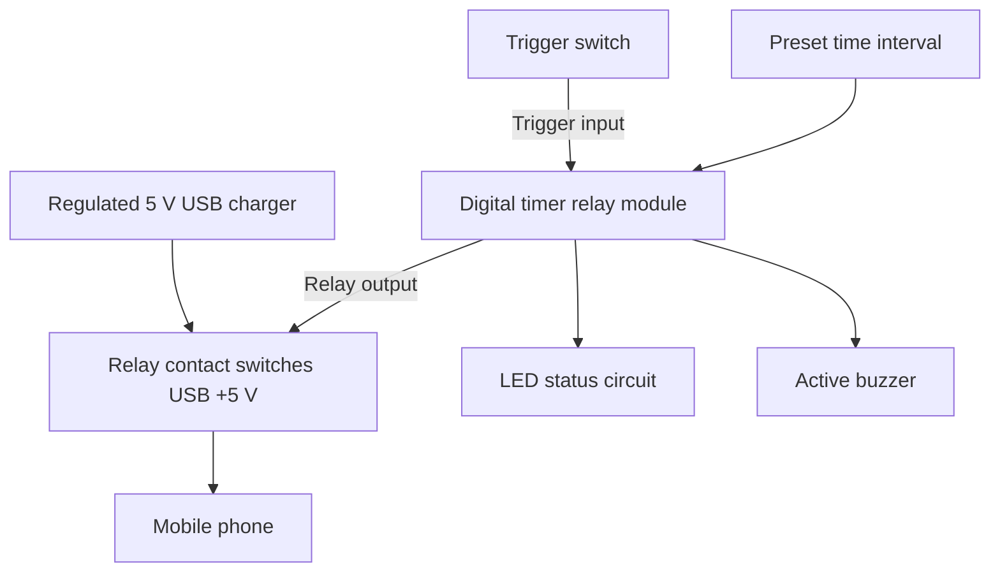

# Functional Block Diagram

This diagram shows functional relationships only. It does not specify terminal numbers, grounds, resistor values, or the exact relay contact selection. Those require the actual module model and verified wiring.
